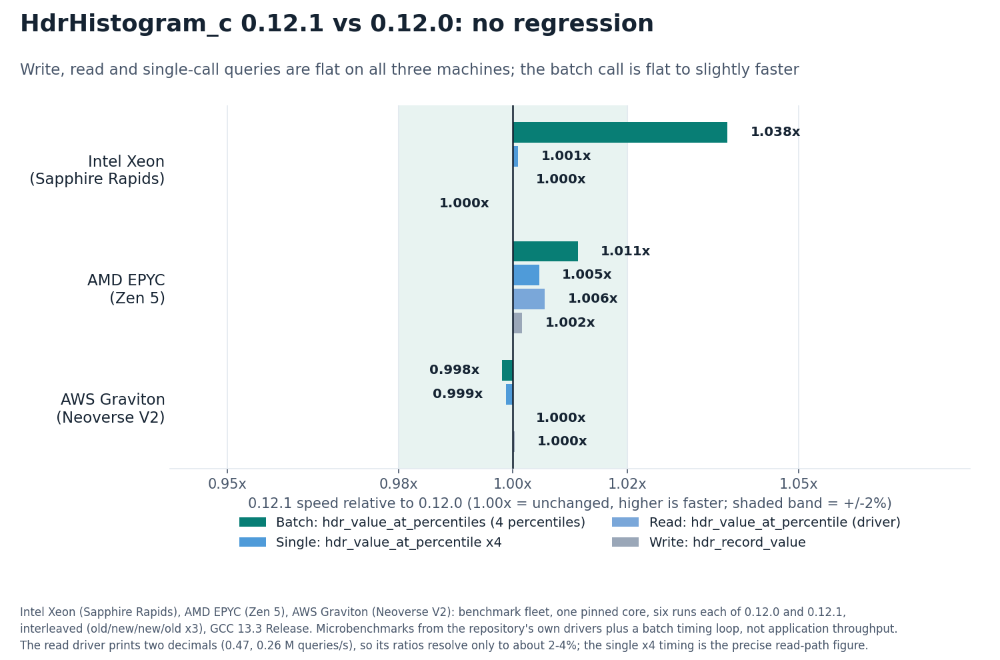
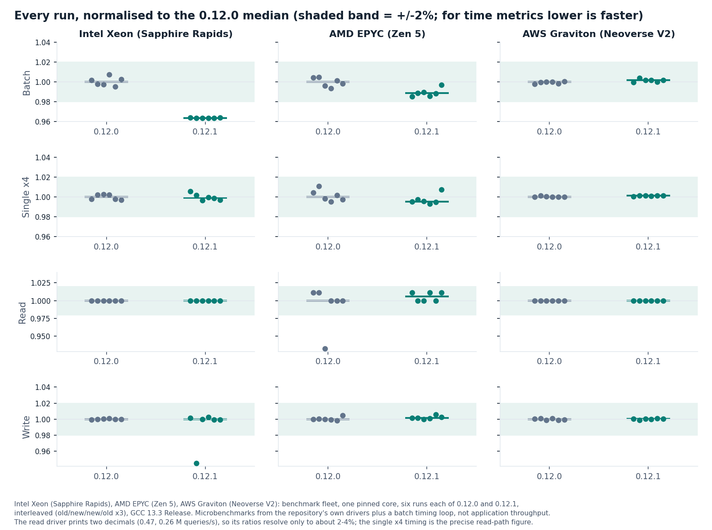
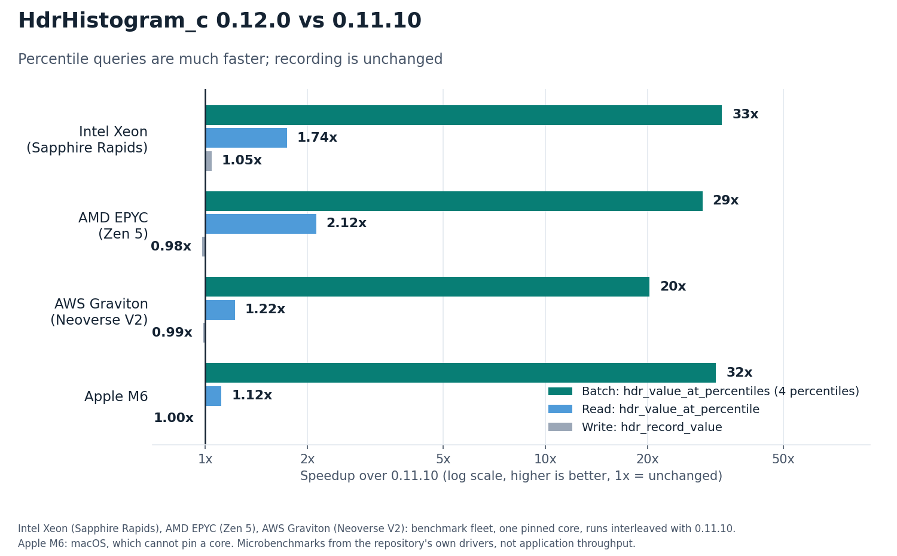

HdrHistogram_c: 'C' port of High Dynamic Range (HDR) Histogram

HdrHistogram
----------------------------------------------

[](https://gitter.im/HdrHistogram/HdrHistogram)

This port contains a subset of the functionality supported by the Java
implementation.  The current supported features are:

* Standard histogram with 64 bit counts (32/16 bit counts not supported)
* All iterator types (all values, recorded, percentiles, linear, logarithmic)
* Histogram serialisation (encoding version 1.2, decoding 1.0-1.2)
* Reader/writer phaser and interval recorder
* Sparse histogram (`hdr_packed_histogram`, see `include/hdr/hdr_packed_histogram.h`): a separate,
  opt-in type whose storage grows with the number of populated buckets, with counts kept in 1, 2, 4
  or 8 bytes as needed. Much smaller when you hold many sparsely populated histograms, at the cost
  of slower recording and no atomic recording; it serialises to the standard compressed format

Features not supported, but planned

* Auto-resizing of histograms

Features unlikely to be implemented

* Double histograms
* Atomic/Concurrent histograms
* 16/32 bit histograms

Embedding the library (minimal static core without zlib/threads, custom
allocator, disabling the AVX2 scan): see [docs/EMBEDDING.md](docs/EMBEDDING.md).

To vendor the library as a few generated files instead of the whole tree, an amalgamation is
attached to each release and generated by `script/amalgamate.py`: the core on its own
(`hdr_histogram.c` and `hdr_histogram.h`), or with the log codec (`--with-log`), and for trees
that keep the headers in a `hdr/` directory (`--include-prefix hdr/`); see
[docs/AMALGAMATION.md](docs/AMALGAMATION.md).

# Performance

Measured on the benchmark fleet with this repository's own drivers (`hdr_histogram_perf`,
`hdr_percentile_bench`) plus a small batch timing loop, one pinned core, new and old releases
interleaved on the same machine. These are microbenchmarks, not application throughput.

**0.12.1 against 0.12.0: unchanged.** 0.12.1 is a bug-fix release; write, read and batch speed
stay within about 1% of 0.12.0 (speed relative to 0.12.0, higher is faster; median of six runs
per release, GCC 13.3, default Release build):

| | Intel Xeon (Sapphire Rapids) | AMD EPYC (Zen 5) | AWS Graviton (Neoverse V2) |
|---|---:|---:|---:|
| `hdr_record_value` (write) | 1.000x | 1.002x | 1.000x |
| `hdr_value_at_percentile`, 4 percentiles as single calls | 1.001x | 1.005x | 0.999x |
| `hdr_value_at_percentile`, repository read driver | 1.000x | 1.006x | 1.000x |
| `hdr_value_at_percentiles`, 4 percentiles (batch) | 1.038x | 1.011x | 0.998x |



<details><summary>Every run, per machine</summary>



</details>

**0.12.0 against 0.11.10: percentile queries are much faster, recording is unchanged.**

| 0.12.0 vs 0.11.10, higher is better | `hdr_value_at_percentile` (read) | `hdr_value_at_percentiles`, 4 percentiles (batch) | `hdr_record_value` (write) |
|---|---:|---:|---:|
| Intel Xeon (Sapphire Rapids) | 1.74x | 33x | 1.05x (inside run-to-run spread) |
| AMD EPYC (Zen 5) | 2.12x | 29x | 0.98x |
| AWS Graviton (Neoverse V2) | 1.22x | 20x | 0.99x |
| Apple M6 | 1.12x | 32x | 1.00x |



Method, commits and caveats are in the release notes:
[0.12.1](https://github.com/HdrHistogram/HdrHistogram_c/releases/tag/0.12.1) and
[0.12.0](https://github.com/HdrHistogram/HdrHistogram_c/releases/tag/0.12.0).

# Simple Tutorial

## Recording values

```C
#include <hdr_histogram.h>

struct hdr_histogram* histogram;

// Initialise the histogram
hdr_init(
    1,  // Minimum value
    INT64_C(3600000000),  // Maximum value
    3,  // Number of significant figures
    &histogram)  // Pointer to initialise

// Record value
hdr_record_value(
    histogram,  // Histogram to record to
    value)  // Value to record

// Record value n times
hdr_record_values(
    histogram,  // Histogram to record to
    value,  // Value to record
    10)  // Record value 10 times

// Record value with correction for co-ordinated omission.
hdr_record_corrected_value(
    histogram,  // Histogram to record to
    value,  // Value to record
    1000)  // Record with expected interval of 1000.

// Print out the values of the histogram
hdr_percentiles_print(
    histogram,
    stdout,  // File to write to
    5,  // Granularity of printed values
    1.0,  // Multiplier for results
    CLASSIC);  // Format CLASSIC/CSV supported.
```

## More examples

For more detailed examples of recording and logging results look at the
[hdr_decoder](examples/hdr_decoder.c)
and [hiccup](examples/hiccup.c)
examples.  You can run hiccup and decoder
and pipe the results of one into the other.

```
$ ./examples/hiccup | ./examples/hdr_decoder
```
